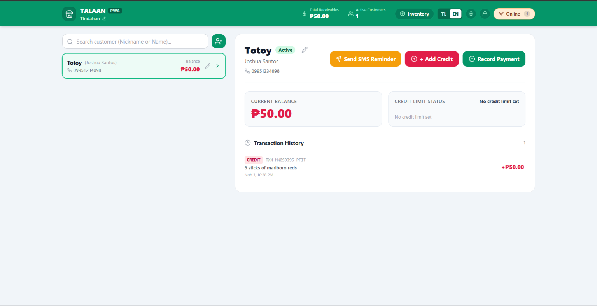
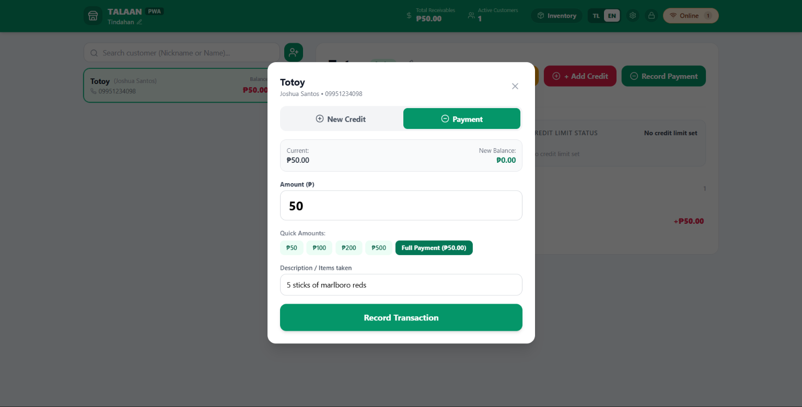
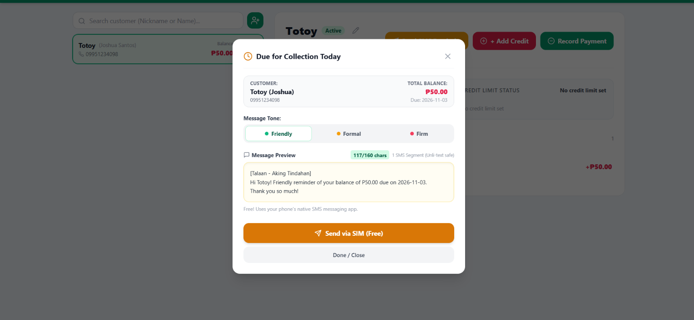
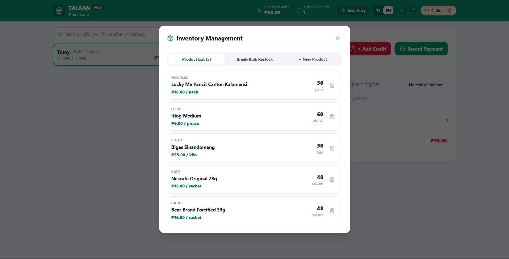

# Talaan (PWA)

> An offline-first, double-entry credit ledger and inventory management PWA built for Philippine sari-sari stores.

[](https://nextjs.org/)
[](https://www.typescriptlang.org/)
[](https://tailwindcss.com/)
[](https://www.prisma.io/)
[](https://neon.tech/)
[](https://developer.mozilla.org/en-US/docs/Web/Progressive_web_apps)
[](LICENSE)

---

<p align="center">
  
</p>

---

## Why Talaan?

Over 1.3 million neighborhood sari-sari stores form the backbone of grassroots retail in the Philippines. However, most store owners (*tindero/tindera*) still track day-to-day customer micro-credit (*utang*) using paper notebooks (*listahan*). 

This reliance on paper leads to severe working capital loss (*pagkalugi ng puhunan*):
- **Physical Loss & Damage:** Notebooks get misplaced, damaged by spills, or torn, causing untracked and unrecoverable debt.
- **Untracked Stock Leakage:** Bulk merchandise broken down into retail units (loose cigarettes, single shampoo sachets, repacked sugar) leaks profit through unmonitored shrinkage.
- **Social Friction (*Hiya*):** Collecting money face-to-face often damages neighborhood relationships due to subjective perceptions of amounts or due dates.

**Talaan** transforms the traditional *listahan* into an offline-first digital counter companion built specifically for the realities of local retail:

### Core Engineering Pillars
- 📶 **Local-First & Offline Resilience:** Operates 100% standalone inside the browser via IndexedDB (Dexie.js). Full counter operations (crediting, payments, restocks) function without internet connectivity and automatically queue into an idempotent outbox that syncs upstream to Neon PostgreSQL whenever an internet connection is detected.
- ⚖️ **Immutable Double-Entry Accounting:** Eliminates rounding drift by storing all financial values as integer centavos. Every single transaction strictly enforces the zero-sum ledger invariant:
  $$\sum \text{Debits} - \sum \text{Credits} = 0$$
- 📱 **Zero-Cost Native SMS via SIM:** Leverages native mobile `sms:` URI schemes to generate clean, formatted counter receipts and payment reminders that send directly through the store owner's existing SIM promos (e.g., Unli All-Net text), bypassing costly per-SMS cloud gateways.
- 📦 **Break-Bulk Inventory Engine:** Tracks bulk case purchases converted into micro-retail units (cases $\rightarrow$ packs $\rightarrow$ piraso/sticks $\rightarrow$ sachets $\rightarrow$ kilos) with real-time margin visibility.

---

## Key Features & Interface Walkthrough

### 1. Customer Credit & Ledger Tracking
<p align="center">
  
</p>

- **Instant Suki Lookup:** Real-time search across customer nicknames, formal names, and phone numbers.
- **Credit Limit Safeguards:** Set maximum borrowing caps per customer to protect working cash flow and avoid difficult collection conversations.
- **Granular Audit Trails:** Transparent, timestamped double-entry transaction ledgers showing exact credit increases, payments, and account balances.

---

### 2. Fast Counter Transaction Logging
<p align="center">
  
</p>

- **High-Velocity Counter Design:** Log credit purchases and payments in seconds with quick-amount chips (₱50, ₱100, ₱200, ₱500, Full Balance).
- **Cart & Loose Item Attachments:** Optionally attach itemized merchandise items from inventory directly into credit purchase records.
- **Custom Due Date Presets:** Schedule settlement dates (e.g., Next Payday, Katapusan, Next Friday) with automatic alert tracking.

---

### 3. Tone-Based SMS Reminders
<p align="center">
  
</p>

- **Culturally Aligned Tone Selector:** Pre-written bilingual (Tagalog/English) templates matching neighborhood dynamics:
  - 🟢 **Friendly (*Malumanay*):** Polite and gentle reminder for trusted, regular sukis.
  - 🟡 **Formal (*Pormal*):** Businesslike balance statement for general customers.
  - 🔴 **Firm (*Madiin*):** Direct and urgent payment demand for significantly overdue balances.
- **GSM-7 Single-Segment Compliance:** Built-in live character counters strictly enforce the $\le 160$ character boundary across all templates, guaranteeing zero multi-segment SMS split charges.
- **Direct SIM Dispatch:** One-tap "I-text via SIM (Libre)" action immediately populates the store owner's native texting app.

---

### 4. Micro-Retail Inventory Management
<p align="center">
  
</p>

- **Multi-Unit Packaging:** Define base units (piraso, stick, sachet) and package multipliers (pack of 20, case of 24, carton).
- **Low-Stock Warnings:** Real-time indicator badges highlight fast-moving merchandise reaching reorder thresholds.
- **Soft-Delete Integrity:** Archiving products or customers uses soft deletion (`is_active = false`), safeguarding historical accounting transactions against dangling foreign-key references.

---

## Technical Architecture

```
┌─────────────────────────────────────────────────────────────┐
│                       Browser / PWA                         │
│                                                             │
│   ┌────────────────────┐          ┌──────────────────────┐  │
│   │  React UI (Next14) │ ───────> │  Dexie.js IndexedDB  │  │
│   └────────────────────┘          │  - ledgerEntries     │  │
│                                   │  - customers         │  │
│                                   │  - syncOutbox        │  │
│                                   └──────────┬───────────┘  │
└──────────────────────────────────────────────┼──────────────┘
                                               │
                        Background Sync Engine │ (Topological Order)
                                               ▼
┌─────────────────────────────────────────────────────────────┐
│                 Cloud / Serverless Edge                     │
│                                                             │
│   ┌─────────────────────────────────────────────────────┐   │
│   │ Next.js API Routes (/api/sync/push, /api/sync/pull) │   │
│   │ - Session Auth & Payload Guards (<= 2MB, <= 100/req)│   │
│   └──────────────────────────┬──────────────────────────┘   │
│                              │                              │
│                              ▼ (Prisma ORM)                 │
│   ┌─────────────────────────────────────────────────────┐   │
│   │ Neon Serverless PostgreSQL                          │   │
│   │ - Connection Pooling via PgBouncer                  │   │
│   │ - Double-Entry Ledger Invariants & Audit Tables     │   │
│   └─────────────────────────────────────────────────────┘   │
└─────────────────────────────────────────────────────────────┘
```

---

## Self-Hosting & Deployment Guide

### Prerequisites
- [Node.js](https://nodejs.org/) (v18.18 or later)
- Free [Neon](https://neon.tech/) account (Serverless PostgreSQL)
- Free [Vercel](https://vercel.com/) account (or any Next.js-compatible host)

### One-Click Deploy to Vercel

Click the button below to deploy your own instance of Talaan directly to Vercel:

[](https://vercel.com/new/clone?repository-url=https%3A%2F%2Fgithub.com%2Falexius-seth%2FTalaanPH&env=DATABASE_URL,DIRECT_URL,STORE_NAME,STORE_PIN,AUTH_SECRET,CRON_SECRET)

---

### Environment Variables

| Variable | Required | Description |
| :--- | :---: | :--- |
| `DATABASE_URL` | **Yes** | Neon pooled PostgreSQL connection string with PgBouncer (`...-pooler...sslmode=require&pgbouncer=true`). |
| `DIRECT_URL` | **Yes** | Neon direct unpooled connection string for migrations (`...sslmode=require`). |
| `STORE_NAME` | No | Initial store name (defaults to `Aking Tindahan`). Can be updated anytime in UI. |
| `STORE_PIN` | No | Default master PIN for the counter lock screen (defaults to `1234`). |
| `AUTH_SECRET` | **Yes** | 32-character random string used to sign HTTP-only session cookies. |
| `CRON_SECRET` | No | Secret bearer token required for automated reminder endpoints (`/api/cron/reminders`). |
| `SEMAPHORE_API_KEY` | No | Optional Semaphore API key if you want automated background SMS dispatch. |
| `SEMAPHORE_SENDER_NAME` | No | Optional Semaphore sender name (defaults to `SEMAPHORE`). |

---

### Local Development Setup

1. **Clone the repository:**
   ```bash
   git clone https://github.com/alexius-seth/TalaanPH.git
   cd TalaanPH
   ```

2. **Install dependencies:**
   ```bash
   npm install
   ```

3. **Configure environment variables:**
   ```bash
   cp .env.example .env
   ```
   *Edit `.env` to supply your Neon PostgreSQL connection strings.*

4. **Sync the database schema:**
   ```bash
   npx prisma db push
   ```

5. **Run the internal sanity test suite:**
   ```bash
   node --experimental-strip-types src/check.ts
   ```

6. **Start the development server:**
   ```bash
   npm run dev
   ```
   Open [http://localhost:3000](http://localhost:3000) in your browser.

7. **Production build verification:**
   ```bash
   npx tsc --noEmit
   npm run build
   ```

---

## Offline Testing & PWA Installation

- **Installing on Mobile:** Open the deployed instance in Google Chrome (Android) or Safari (iOS), tap the menu, and select **"Add to Home Screen"** or **"Install App"**.
- **Offline Simulation:** In Chrome DevTools, open the **Network** tab and toggle the throttling dropdown to **Offline**. All counter operations, transaction logs, and customer views continue running seamlessly.

---

## License

This project is open-source and available under the [MIT License](LICENSE).
